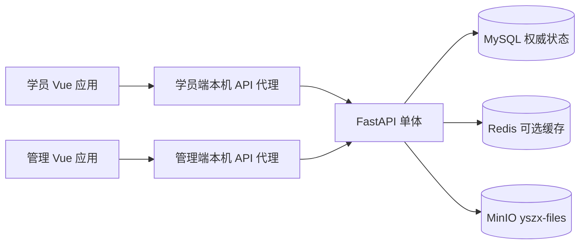

# 云枢智学：整体架构设计

> 当前基线：用户已授权基础工程开发，并确认切换 MySQL，接入 Redis、MinIO。本文件定义现行架构；原 SQLite 阶段的讨论记录归档至 `docs/history/`。基础工程实现与业务功能实现须分开验收。

## 1. 范围与技术选型

首发以学习路线、课程分集、客观题练习及错题为核心，提供最小后台和个人中心；AI 面试保留入口暂不开放。手机号、短信、多角色、AI 评分与完整运营能力均为后续。三个学科为 Python 基础、VibeCoding 基础、数据库基础。

| 层 | 技术 | 现行职责 |
|---|---|---|
| 学员端 | Vue 3、Vite、TypeScript、Vue Router、Pinia、Element Plus | 独立应用、构建、路由和身份状态 |
| 管理端 | 同上 | 独立应用及管理员账号域，不能替代学员身份 |
| 后端 | Python 3.13、FastAPI | 单体服务，按业务模块分层；基础工程提供配置、响应、错误与连接检查 |
| 数据访问 | SQLAlchemy、PyMySQL、Alembic、MySQL 8.4 | 业务事实、登录会话、登录锁定及频控状态持久保存；无物理外键 |
| 缓存 | Redis | 可丢失的辅助缓存，不能作为已确认持久状态的唯一来源 |
| 对象存储 | MinIO | 本机 S3 对象存储，使用已存在的私有桶 `yszx-files`；首发仍不开放头像上传 |
| 依赖与验证 | uv/uv.lock、npm workspaces/package-lock、Ruff、pytest、vue-tsc/Vite | 固定依赖、检查、测试及独立前端构建 |

## 2. 服务边界和目录



浏览器仅访问 HTTP API，不读取数据库文件或存储密钥。开发服务器都监听本机地址；学员入口 `127.0.0.1:5173/`，后台 `127.0.0.1:5174/admin/`，API `127.0.0.1:8000`。两个 Vite 服务器将 `/api` 同源代理到后端。生产反向代理和 TLS 尚不属于本次交付，开发服务器不能当作生产部署。

```text
backend/
  app/entry/           配置、应用工厂及本机配置生成工具
  app/common/          统一响应与共享接口类型
  app/infrastructure/  MySQL metadata、连接池及三服务依赖
  app/modules/         后续业务模块
  migrations/          Alembic 和冻结的初始 SQL 快照
  tests/               隔离基础测试
frontend/
  portal/              学员端独立应用
  admin/               后台独立应用
  shared/              不持有身份的公共组件、类型及请求封装
docker/local/          三项基础服务配置
scripts/sql/           当前 MySQL 导出及历史 SQLite 草案
docs/development/      工程交付与启动说明
```

请求层解析输入、认证和映射错误；业务层实施状态、权限与事务；持久化层执行数据操作和约束。跨表逻辑关联须由服务端在同一业务事务内校验，禁止 SQL 或 ORM 创建物理外键。JSON 和数据库字段 snake_case，前端变量 camelCase，其他工程规范见 `docs/rules/development-rules.md`。

## 3. 核心业务协作

1. 学科包含阶段；课程唯一归属一个阶段，归属学科由阶段推导，可关联其他学科供路线引用。跨学科引用不计入引用方阶段完成条件。首发课程录入后不能直接更改所属阶段。
2. 分集进度按学员、课程、编号保存，跨路线共享。已有集序不变，新视频只追加；总数减少保留超范围历史，增加时按现有事实重算。阶段完成需要至少一门当前上架且未删除归属课程、全部该类分集完成、至少一次完整阶段练习；条件回退时当前状态回退。
3. 阶段题库随机最多 10 题，题目不足按实际数量，零题不创建。错题复习只抽未移除、未掌握且可作答题。一人最多一轮进行中，可续练或放弃；放弃保留已判定作答及错题，不计完整练习和学习日。
4. 同轮同题只判定一次并返回首次结果；作答、选项快照、错题和轮次完成必须一致提交。所有已判定答题计入正确率，含未完成轮次；只有已完成练习按上海自然日产生学习日。
5. 连续答对 3 次自动掌握，首发无手动掌握、移除、统计卡或 Top 3；已掌握题再错仍掌握，累计错数增加。实质改题重新上架对比掌握重置指纹；指纹不含题型，作答版本号独立递增以识别旧页面。
6. 下架、题目或所属学科/阶段逻辑删除、阶段禁用会影响未作答题。移除后不回填原轮；全部不可用且无已判定作答时自动结束为未完成。阶段禁用不阻止所属已上架且未删除课程访问及标记进度。
7. 学科/阶段删除记录实际变化批次；可仅恢复父级、逐项恢复或恢复整批剩余内容。先恢复有效父级，名称冲突加既定后缀，课程完整链接冲突暂停本次恢复事务；此前已恢复内容不回滚。独立删除课程保留路线引用但隐藏，恢复后原有效引用重新显示。

## 4. 身份与运行状态

两端独立 HttpOnly Cookie 和服务端会话；普通学员与后台会话固定 7 天，临时密码改密会话 15 分钟。改密成功保持本次登录、撤销其他学员会话、从成功时重新计算 7 天；普通改密还撤销未使用临时密码。首发注册成功后手动登录。

学员连续 5 次密码错误锁定 5 分钟。后台不按连续失败次数锁定，同来源 IP 每个固定 5 分钟窗口最多 10 次请求，MySQL 保存计数，重启后按窗口生效。Redis 可缓存可丢失数据，但不替代 MySQL 的权威记录。管理端身份、Cookie、CSRF 来源校验和后台频控已于 2026-11-10 实现；学员认证及练习签名令牌仍待实现。管理端安全契约见 API 设计的管理端实施补充。

## 5. 当前交付、验证与后续

已实现双前端工程、真实依赖状态页面、FastAPI 工厂、统一响应及错误、配置、三项服务客户端、SQLAlchemy 24 表 metadata 和初始迁移。健康检查 `/api/v1/health` 仅检查进程；就绪检查 `/api/v1/ready` 验证 MySQL/Redis/MinIO 桶，返回 200 或 503。Redis 虽仅作业务可选缓存，工程联调检查仍展示其真实状态。

应用启动不会自动建表或创建桶，迁移由显式命令执行；初始迁移拒绝非空业务库。MySQL DDL 非事务回滚，失败后需检查并恢复，不自动删库。原有 SQLite 草案保留以便审计，不提供自动旧数据转换。

管理端已实现 Cookie/CSRF 及密码输入校验；后续业务实现前仍需落实学员认证、签名密钥与版本校验、业务并发事务、数据备份与迁移。基础测试、类型检查和构建不能代替业务验收。具体启动及验证命令见根 README，原型和完整功能规划仍作后续参考。


## 2026-11-11 系统管理实施更新

用户已明确将角色管理、后台用户管理、操作日志和平台基本设置纳入当前开发；本条更新此前延期范围。采用增量迁移0002，保留原管理员为唯一超级管理员，后台用户每人一个角色。新增角色、权限、审计、临时密码、平台设置及文件元数据共6张表，现共30张表，无物理外键。重置使用一次性临时密码，登录后强制改密；日志仅查询、详情与CSV导出，不提供清空。详细数据库、接口与实施边界见 `docs/development/系统管理模块.md`；原型中的默认密码、日志清空不再适用。
