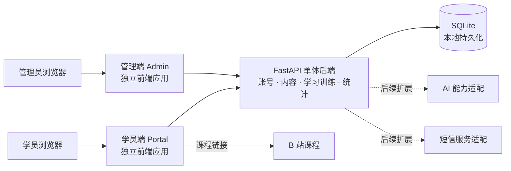
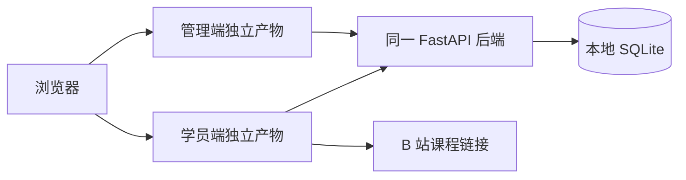
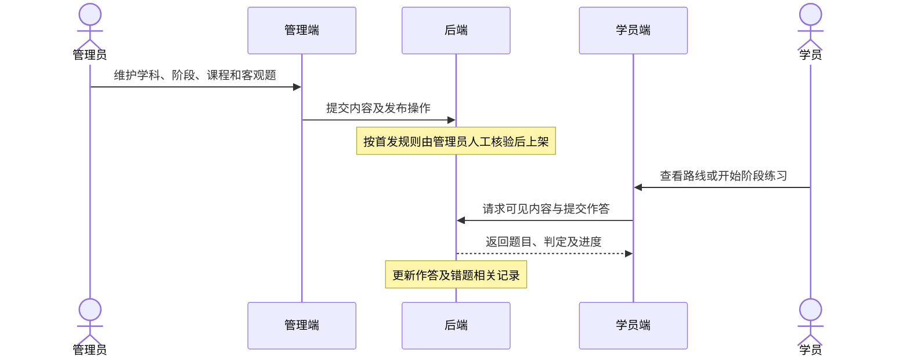
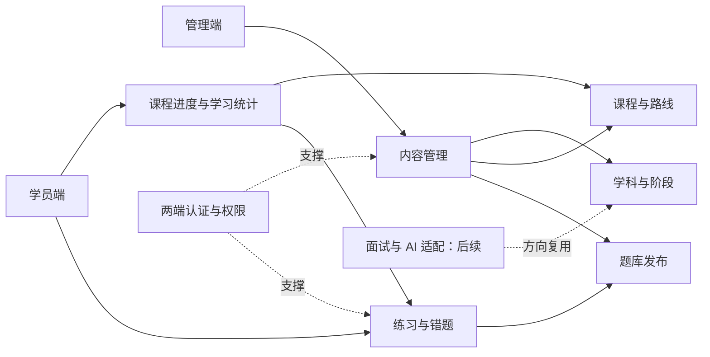
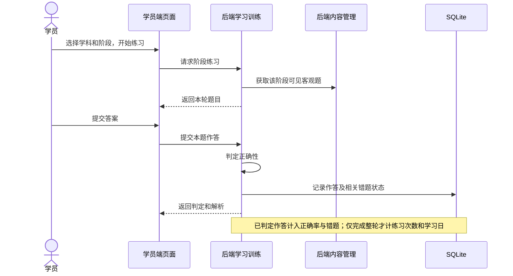
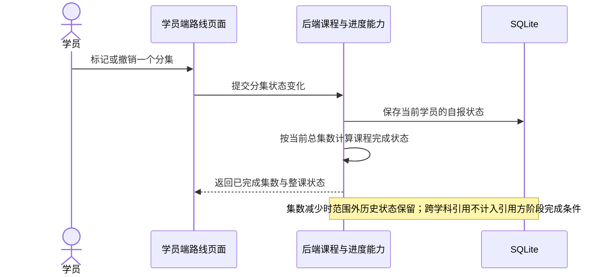

# 云枢智学：技术选型与整体架构设计

> 状态：讨论稿，待用户审核。首发本地学习刷题验证版、SQLite、Python + FastAPI、SQLAlchemy、双前端独立部署并共用单体后端、Vue 3 + Vite + TypeScript、Vue Router + Pinia + Element Plus，以及使用 SQLite 保存登录锁定与首发接口频控计数、不单独部署 Redis 已获用户确认；其他未确认的技术选择仍为建议。本文件不定义表结构、接口契约或业务代码。

## 1. 依据、范围与约束

- 功能依据：`docs/design/01.功能模块梳理.md`、`docs/云枢智学-需求文档.md` 和 `prototype/`。需求与原型包含完整训练和运营能力；原型为 HTML/CSS/JS 模拟页面，不代表后端功能已实现。
- 用户确认的版本边界：首发是本地、小范围学习刷题验证版；完整 AI 面试、短信登录、多角色管理等能力作为后续扩展设计。第一阶段新文档中有关“本期完整功能”的表述与此存在冲突，以本轮确认的版本边界为本方案依据，冲突项列入第 8 节。
- 已确认技术约束：首发 SQLite；后端 Python + FastAPI。首发学员使用用户名和密码，后续手机号或第三方登录应绑定既有学员账号。
- 两端独立：学员端和管理端独立部署，账号和登录态独立；用户已确认两端共用一个 FastAPI 单体后端。
- 本阶段仅讨论整体方案与模块职责；未设计具体表、字段、索引、接口路径或报文，也不修改原型和业务代码。

## 2. 技术选型建议

| 方面 | 首发方案 | 状态与依据 | 后续扩展或触发条件 |
|---|---|---|---|
| 学员端与管理端 | Vue 3 + Vite + TypeScript，使用 Vue Router、Pinia 和 Element Plus，两个独立前端应用 | **已确认**。两端各自维护路由和公共状态，登录态保持独立；后台优先复用通用表格、表单和弹窗，学员端结合现有 HTML 原型调整样式。原型作为页面参考，不假定可直接替换为生产应用。[Vue 官方快速入门](https://vuejs.org/guide/quick-start)说明了 Vue/Vite 的应用组织方式 | 各依赖的具体版本尚未确定 |
| 服务端语言及框架 | Python + FastAPI | **已确认**。使用 Python 组织学习、管理和未来 AI 集成能力；框架选择不等于 Python 自带 FastAPI，后续实施需安装依赖 | 模块按业务职责划分，AI 和短信等外部依赖通过独立适配边界接入 |
| 数据持久化 | SQLite，由服务端读写 | **已确认**。适合本地受控验证，免独立数据库服务；SQLite 并不等于 Python 自带的完整后端框架。[SQLite 适用场景](https://sqlite.org/whentouse.html)说明其单文件及服务端使用模式 | 多进程/多实例持续写入、远程共享或规模增长时评估迁移到客户端/服务端数据库；具体产品与迁移设计届时确认 |
| 数据访问 | SQLAlchemy | **已确认**。通过独立数据访问层操作 SQLite，使业务规则与具体存储访问分离；不因此保证未来迁移数据库无需改造 | 具体表结构、数据迁移方式与依赖版本在后续设计时确定 |
| 缓存、限流 | 首发不单独部署 Redis；登录失败次数、锁定时间以及登录、注册等首发接口的频控计数使用 SQLite 保存；进程内缓存仅存放允许丢失的临时数据 | **已确认**：后端重启后，登录锁定及其他首发接口频控计数仍按其有效期生效；具体首发接口清单和未定阈值后续核对 | 多实例或需跨进程一致限流时评估 Redis。官方说明本地计数无法跨实例统一，Redis 可提供共享计数：[Redis 限流文档](https://redis.io/docs/latest/develop/use-cases/rate-limiter/) |
| 身份与权限 | 学员端和管理端各自独立登录态；首发仅超级管理员后台；学员会话状态由服务端保存在 SQLite | 普通学员会话自登录成功起固定有效 7 天，普通登录态改密成功后本次会话从成功时重新计算 7 天；临时密码登录后的受限改密会话有效 15 分钟，改密成功后普通会话的 7 天从成功时起算；两端分别采用 HttpOnly Cookie；后台会话独立保存在 SQLite，固定有效 7 天；具体 Cookie 安全策略待细化 | 后续增加角色权限及登录方式时保持同一学员身份，绑定验证和冲突规则另议 |
| AI、语音与短信 | 首发不接真实 AI 面试或短信；AI 面试仅展示“即将上线” | 首发边界已确认；完整规划中的简答批改、面试、语音与验证码为后续能力 | 服务商、模型、语音支持范围、成本、超时和失败处理待对应阶段确认；不预设具体供应商 |
| B 站课程 | 浏览器跳转 B 站，学员在站内逐集维护进度；全部完成时自动标记整课完成 | 已确认；课程唯一归属一个学科阶段，其他学科可关联引用，但不计入引用方阶段完成条件 | 集数减少时保留超出范围的历史记录；分集编号稳定，新视频只追加在末尾 |

## 3. 整体架构建议

采用用户已确认的**双前端 + 单体后端**：两端可分别构建和部署，本地验证时访问同一 FastAPI 后端；服务端负责统一处理业务规则、持久化与访问控制。按业务模块分层的组织方式仍为建议；该架构不预设微服务、网关或消息队列。



**边界说明**：两端独立部署是既有要求，不要求首发运行两个后端；后台账号与学员账号、各自登录态保持独立。SQLite 仅由后端访问，浏览器不直接访问数据库文件。AI 和短信节点代表后续能力边界，不代表首发接入已选定供应商。

### 3.1 逻辑分层

| 层次 | 职责 | 不负责 |
|---|---|---|
| 展示与交互 | 两端路由、页面、表单校验、进度与错误提示 | 不能以页面隐藏替代后端权限判断；不直接操作持久化文件 |
| 请求处理 | 识别端和登录状态、校验输入、转换业务结果与错误 | 不在此固化页面细节或重复实现业务规则 |
| 业务模块 | 内容发布、阶段练习、判题、错题掌握、进度统计等规则；保证跨模块业务一致 | 不让 AI、短信或数据库供应商细节进入核心规则 |
| 存储与外部能力适配 | 业务数据读写；后续封装 AI 和短信服务交互 | 不自行决定题目上架、掌握状态等业务规则 |

这一分层是职责建议，不预先指定接口规范、组件数量、持久化模型或部署工具。

### 3.2 本地验证部署视图



该图表达首发组件之间的访问关系，不指定端口、域名、反向代理、容器或生产部署方式。两端独立构建和部署，共用后端；后端运行位置、静态资源托管方式及本地启动流程在实施前确定。SQLite 的备份需要与数据库状态保持一致，并验证恢复过程；本阶段不设计备份脚本。

## 4. 业务模块位置及依赖

| 业务模块 | 位置与职责 | 主要依赖或产出 | 首发状态 |
|---|---|---|---|
| 学员账号与个人中心 | Portal 页面 + 后端学员账号/资料能力 | 绑定学习数据；登录恢复规则按首发约定 | 纳入；后续绑定手机或第三方身份 |
| 学科、阶段、课程、路线 | Admin 内容维护；Portal 路线展示；后端统一内容规则 | 每门课程唯一归属一个学科下的一个阶段；可与其他学科关联并被其路线引用，但不计入引用方阶段完成条件 | 纳入最小内容维护 |
| 题库、练习与错题 | Admin 录题与发布；Portal 浏览、作答及复习；后端判分和维护错题状态 | 客观题标准答案、练习记录、连续纠正次数 | 首发只做客观题、最多 10 题及三次连续掌握 |
| 学习进度与统计 | Portal 分集进度/个人中心；后端记录和统一计算 | 课程自报进度、完成练习、正确率；阶段完成状态随归属课程进度同步计算 | 纳入，其他数据口径继续核对 |
| 后台账号及内容管理 | Admin 登录、内容维护和基础学员查看；后端隔离学员与后台身份 | 首发超级管理员和人工核验题目 | 纳入最小后台 |
| AI 面试、面试题库及报告 | Portal 面试页面；Admin 面试题库；后端面试业务与 AI 适配 | 学科作为面试方向；具体题源选择和评分依据待确认 | 首发仅占位；其他后续扩展 |
| 角色、审计与运营概览 | Admin 角色权限、日志及看板；后端鉴权与统计支撑 | 后续管理角色、九组权限和日志范围以需求核对为准 | 最小后台以外能力后续扩展；不将模拟看板数据当真实指标 |

### 4.1 内容到学习的协作



流程为业务层说明，不是接口契约。首发已确认未完成轮次中已提交并判定的作答计入总体正确率、错误作答进入错题本；该轮不计完整练习次数和学习日。重复提交同一轮同一题只计一次并返回首次已保存的判定结果。错题重做使用当前已上架版本，下架或逻辑删除期间暂不可重做，历史作答快照和判定保留。允许返回继续未完成轮次；每位学员最多一轮进行中练习，阶段练习与错题复习共用；允许手动放弃，保留已判定作答及错题；全部题目因下架或题目、所属阶段、学科逻辑删除或所属阶段被禁用而不可作答且没有判定作答时自动结束为未完成；两种情况均不计完整练习和学习日。并发实现及历史展示仍待细化。

### 4.2 后续 AI 面试边界

面试业务负责会话、题目、评分结果和报告的业务流程；AI 适配负责对接外部模型并返回可供业务验证的结果。服务端不应把模拟分数当作真实评分。面试题按学科方向组织，但检索与生成的结合方式、出题策略、失败重试与报告可靠性均未确定；这些内容应在开启面试迭代前经用户确认。

### 4.3 功能到架构的追溯

下表将第一阶段功能、前后台职责与核心数据的使用关系对应起来。模块名称是设计层面的组织建议，不是已经存在的代码包或接口。

| 第一阶段功能 | 前端职责 | 后端职责与依赖 | 首发 / 后续 |
|---|---|---|---|
| 账号与门户 | 学员端注册、登录、首页及引导；管理端单独登录 | 分别识别学员和管理员；首页读取允许展示的学习统计 | 首发用户名密码；短信、第三方为后续 |
| 学科、阶段、课程、路线 | 管理端维护内容；学员端浏览路线、跳转 B 站、维护分集状态 | 管理内容归属、跨学科关联和路线顺序；按已确认规则计算课程进度 | 首发最小内容管理；复杂运营能力后续 |
| 题库、练习与错题 | 学员端按阶段选题、答题、看解析、复习错题；管理端录题与发布 | 只向学员提供可见题目；执行客观题判定、错题连续纠正及统计所需记录 | 首发客观题与人工核验上架；简答批改后续 |
| 学员资料与学习统计 | 个人中心展示学习数据；管理端查看基础学员资料 | 读取同一学员的作答和课程进度，统一统计口径 | 首发基础信息与学习统计 |
| 面试与面试题库 | 面试入口、配置、问答、报告与记录；管理端维护面试题 | 面试方向复用学科；题源选择、评分和外部模型对接另行确定 | 首发仅“即将上线”；完整能力后续 |
| 用户、角色、权限与审计 | 管理端展示管理入口及后续权限配置 | 区分两端身份；服务端执行访问控制；后续扩展多角色与操作日志 | 首发超级管理员；多角色及完整审计后续 |

### 4.4 模块协作与边界建议

1. **内容与练习分工**：内容管理维护学科、阶段、课程、路线和题目的发布状态；学习训练读取允许学员使用的内容，并负责答题与错题规则。课程被其他学科引用时，不改变其唯一归属阶段。
2. **认证与业务分工**：认证能力识别当前访问者及所属端；管理操作仍由后端校验权限。前端路由守卫和按钮显隐用于交互，不能作为唯一授权依据。
3. **统计口径集中**：首页、个人中心和后台学员详情若展示同一指标，应复用同一业务定义；课程进度是学员自报，不能转述为已验证的 B 站观看记录。当前正确率和学习日口径以已确认首发规则为依据，未覆盖的边界继续列为待确认。
4. **跨模块依赖**：建议业务模块通过明确的模块能力协作，避免把其他模块的内部存储细节散落到调用方；跨模块操作的原子性和失败处理，在详细设计时结合具体用例确定，不预设所有操作处于同一事务。
5. **外部依赖隔离**：B 站以课程链接跳转；后续 AI、短信的供应商调用集中在适配边界。超时或失败应如实反馈，不以模拟评分冒充实际结果；具体失败后的交互规则留待对应功能阶段确认。
6. **题目修改与错题状态**：首发对已上架题目的题干、选项或标准答案作实质修改前先下架；重新核验上架时，将最终内容的比较用指纹与上次上架基线比较，变化时重置相关错题连续纠正次数并更新基线。首次上架建立基线；题型不计入该重置比较指纹，单独改变题型不重置掌握状态，旧页面作答的版本和判分安全须独立校验；历史作答快照和累计错误次数保留，仅修改解析或内部来源不重置。学员已打开但未提交的旧题发生实质更新并重新上架后，旧答案不判分，需提示并重新获取当前版本；提交时题目仍下架，或题目、所属阶段、学科已逻辑删除或所属阶段已禁用则移除该题并减少本轮题数，完成余题即可完成本轮。若所有题目均因下架移除且没有已判定作答，本轮未完成、不计完整练习次数和学习日；其他原因无法获取题目时的处理待确认。
7. **练习清单与版本**：服务端保存每轮抽题清单及提供给学员的题目版本标识，供版本校验与防止重复计分使用；支持继续未完成轮次，具体恢复入口仍待细化。并发提交和版本校验的具体实现需结合接口设计确认。



图中连线仅表示业务依赖和信息使用关系，不指定数据库连接、接口契约或精确调用方向；实际模块依赖规则在实施方案中进一步审核。

### 4.5 关键运行流程：练习与课程进度





首发阶段完成需要至少有一门当前已上架且未逻辑删除的归属课程，完成全部符合条件的归属课程分集，并至少完整完成一轮对应阶段练习。没有符合条件的归属课程时，即使完成练习也不能判定为已完成。已完成阶段的归属课程因撤销分集或增加未完成分集而回退时，阶段状态同步回退；课程重新完成且原有阶段练习记录仍满足条件时，阶段自动恢复完成。跨学科引用课程不计入引用方阶段完成条件。

## 5. 建议的项目目录

以下是待确认的组织方案，不表示这些目录已经存在，也不要求修改现有 `prototype/`：

```text
云枢智学/
├── docs/                    # 需求、规则与阶段性设计文档
├── prototype/               # 现有静态页面原型
├── frontend/
│   ├── portal/              # 学员端应用：页面、路由、组件及请求封装
│   ├── admin/               # 管理端应用：页面、路由、组件及请求封装
│   └── shared/              # 经验证适合两端共用的界面或工具；不预设共享身份
├── backend/
│   ├── app/
│   │   ├── entry/           # 应用启动、请求处理与配置入口
│   │   ├── modules/         # 账号、内容、练习、错题、统计等业务模块
│   │   ├── infrastructure/  # 存储及后续外部服务适配
│   │   └── common/          # 错误处理、日志等通用能力
│   └── tests/               # 后端业务及关键流程验证
└── data/                    # 建议的本地运行数据位置；备份与版本管理策略待定
```

具体目录和边界随实际技术方案确定；SQLite 数据文件、用户头像或其他运行数据的保存、备份及版本管理细则将在实施前确定。

### 5.1 目录内部职责建议

| 位置 | 建议内容 | 边界 |
|---|---|---|
| `frontend/portal/` | 学员端页面、路由、Pinia 状态、组件、样式与后端访问封装 | 学员登录状态独立维护；AI 面试首发为占位页 |
| `frontend/admin/` | 后台登录、学科/课程/题库/路线、基础学员查看等页面及对应状态 | 独立于学员端的登录态；隐藏入口不能替代服务端鉴权 |
| `frontend/shared/` | 在实际实现后确认可复用的无身份耦合内容 | 是否创建共享包、如何构建及管理依赖尚未确定 |
| `backend/app/entry/` | FastAPI 应用入口、输入校验、请求处理和配置装配 | 不将题目判定、错题掌握等规则写入页面层 |
| `backend/app/modules/` | 账号、学科与阶段、课程与路线、题库、练习与错题、学习统计等业务能力 | 按职责协作，不要求提前建立全部后续 AI 和角色模块 |
| `backend/app/infrastructure/` | SQLite/SQLAlchemy 访问和后续外部服务适配 | 不绕过业务规则直接决定发布、进度或权限状态 |
| `backend/tests/` | 关键业务规则与两端访问边界的验证 | 具体测试范围与工具在实施计划中确认 |

以上是逻辑分类，实际包名、是否单独创建 `shared/` 和依赖管理方式待实施前确认；不从参考文档引入 Java 包结构、MySQL/Redis/MinIO 部署或未经确认的工具。

## 6. 关键决策记录

| 编号 | 决策 | 状态 | 理由 / 下一步 |
|---|---|---|---|
| D1 | 首发本地学习刷题，完整能力后续迭代 | 已确认 | 避免完整规划与首发范围混淆 |
| D2 | 首发使用 SQLite | 已确认 | 支持本地受控验证；扩展时重新评估并发与部署 |
| D3 | 后端 Python + FastAPI | 已确认 | 用户选择；不代表依赖已经安装或业务已经实现 |
| D4 | 双前端独立部署，共用 FastAPI 单体后端 | 已确认 | 两端账号与登录态保持独立，满足本地验证及独立部署要求 |
| D5 | 两端采用 Vue 3 + Vite + TypeScript | 已确认 | 两端分别组织页面与构建；Vue Router、Pinia 和 Element Plus 分别见 D12、D13 |
| D6 | 首发不单独部署 Redis；SQLite 保存登录锁定状态和首发接口频控计数 | 已确认 | 重启后登录锁定及登录、注册等首发接口频控计数按有效期继续生效；具体接口清单和未定阈值后续核对 |
| D7 | AI、短信按后续适配接入 | 规划，供应商待确认 | 首发不接入；后续按能力与失败策略确定 |
| D8 | 课程唯一归属一个学科下的一个阶段，可关联其他学科并供其路线引用 | 已确认 | 跨学科引用不将课程计入引用方阶段完成条件；课程与学科可形成多对多关联 |
| D9 | 整课完成由分集状态自动计算 | 已确认 | 全部分集完成后计入已学课程；撤销任一分集时状态与统计回退 |
| D10 | 课程总集数变更时按当前总数重新计算进度 | 已确认 | 增加时无历史记录的新增分集默认未完成；减少时保留超出范围的历史完成记录但不计入当前进度，日后恢复集数时原有状态重新生效。分集顺序不变、已有分集不替换，新视频只追加末尾，平台仅维护分集编号 |
| D11 | 首发课程必须归属已有学科及其阶段，不设“其他学科”兜底项 | 已确认 | 无法归类的课程暂不录入；保留其他学科的路线对已有课程的跨学科引用 |
| D12 | 两个前端使用 Vue Router 和 Pinia | 已确认 | 两端分别维护路由与公共状态，学员端和管理端登录态独立 |
| D13 | 两个前端使用 Element Plus | 已确认 | 后台优先复用表格、表单及弹窗；学员端结合原型调整样式，具体版本待定 |
| D14 | 后端使用 SQLAlchemy 访问 SQLite | 已确认 | 通过独立数据访问层隔离业务规则；数据库迁移和具体表设计另行讨论 |
| D15 | 首发阶段完成状态随归属课程进度同步计算 | 已确认 | 阶段仅计算已上架且未逻辑删除的归属课程，须至少有一门符合条件的课程并完成一轮对应阶段练习；无符合条件的课程时不能完成；归属课程回退时阶段回退，课程重新完成且原练习记录仍满足条件时自动恢复 |
| D16 | 课程进度跨路线共享；学习日按 `Asia/Shanghai` 自然日计算 | 已确认 | 同一学员在不同路线学习同一课程使用同一分集进度；持久时间格式与转换见数据库设计 |
| D17 | 学科或阶段与归属课程级联逻辑删除；仅恢复本次级联删除内容 | 已确认原则 | 引用共享课程的其他路线受影响，操作前提示；课程恢复后仍有效路线的原引用重新可见，之前单独移除的引用不恢复。名称冲突自动加后缀；批次内课程链接冲突时暂停整个批次恢复 |
| D18 | 一次性临时密码不设时间期限 | 已确认 | 成功使用一次后失效，须设置新密码；改密成功前原密码仍有效。使用后关闭页面可使用原密码或让管理员重新生成；新密码设置成功后本次会话直接进入平台，其他已有会话失效 |
| D19 | 课程不展示也不使用 BV 号 | 已确认 | 按保存的完整课程链接完全一致去重，不处理参数差异；恢复时链接冲突会暂停整个批次 |
| D20 | 学员会话状态保存在服务端 SQLite；普通会话自登录成功起固定有效 7 天，普通登录态改密成功后从成功时重新计算 7 天 | 已确认 | 区分正常会话与临时密码改密过程、保留当前会话并撤销其他会话；受限会话及转换期限见 D23，两端使用独立 HttpOnly Cookie；后台独立 SQLite 会话有效 7 天 |
| D21 | 同一轮次同一题目重复提交只计一次 | 已确认 | 返回首次已保存的判定结果，不重复更新答题、错误和纠正计数；服务端验证归属与并发一致性 |
| D22 | 首次学习方向引导选择或跳过后不再自动弹出 | 已确认 | 学员可在个人中心修改偏好；偏好不限制访问其他方向 |
| D23 | 临时密码登录后的受限改密会话有效 15 分钟 | 已确认 | 临时密码本身一次有效且不设时间期限；改密成功后普通会话的 7 天从成功时起算 |
| D24 | 已掌握错题再次答错仍保持已掌握 | 已确认 | 未移除时仅增加累计错误次数；待复习题答错连续纠正次数归零；移除后再次答错则重新显示，保留并增加累计错误次数、连续纠正次数归零并回到待复习，实质改题后的重置规则仍然适用 |

## 7. 风险与验证重点

1. **范围冲突**：第一阶段文件与需求文档仍将短信、AI 面试、多角色等描述为本期；本设计依据用户后续确认，将其列为首发后的扩展。此前已按逐项确认同步课程归属与进度规则，但首发范围尚未在两份原文中整体统一，后续阶段应以本设计标明的首发边界为准并先处理差异。
2. **SQLite 使用边界**：SQLite 不适合依靠共享文件实现多实例高并发写入；备份应避免直接复制活跃数据库导致不一致，应在详细实施时选择可靠的备份流程并演练恢复。[SQLite 适用场景](https://sqlite.org/whentouse.html)
3. **频控与运行边界**：登录锁定及首发接口频控计数由 SQLite 保存，重启后按有效期生效；进程内缓存只用于允许丢失的临时数据。未来多实例部署时需重新评估共享存储、并发写入与一致性。
4. **学习数据可信度**：B 站分集完成状态由学员自报；页面和统计不能表述为平台核验了实际观看。跨学科引用课程不计入引用方阶段完成条件。
5. **需求冲突影响技术边界**：人工核验与原文审核流程、账号方式等，均须先厘清首发和完整规划之间的规则，再进入数据库和 API 详细设计。
6. **外部能力可用性**：AI、语音、短信可能不可用或返回错误；后续设计需定义失败、恢复和数据保护，不使用原型模拟结果代替真实能力。
7. **状态演变与重复提交**：课程进度、完成状态、错题纠正和学习统计相互依赖；实施前应明确重复提交、中断及内容变更时的行为，并验证同一指标在不同页面的一致性。
8. **前后台边界**：两端前端独立并不自动构成权限隔离；应在后端验证当前账号所属端及允许的管理操作。具体会话机制和权限细则尚待确认。
9. **参考材料边界**：参考版使用另一套 Java、MySQL、Redis 等技术方案，且包含其他上下文中的确认标记；这些实现和标记不自动适用于本项目，也不构成对新增服务的授权。

## 8. 待确认问题

| 优先级 | 问题 | 对架构的影响 |
|---|---|---|
| 中 | 首发除登录、注册外，哪些接口需要频控？尚未定稿的请求频率阈值如何确定？ | 决定首发频控覆盖范围和阈值；存储及重启语义已确认 |
| 中 | 首发题目草稿—人工核验—上架与完整规划待审核流程如何衔接？ | 决定内容发布流程及未来角色扩展 |
| 中 | 登录绑定验证、受限改密会话和其他会话失效如何实现？ | 已确认成功改密后本次会话进入平台、其他已有会话失效；具体会话实现仍待确定 |
| 高 | 删除批次的恢复顺序及并发冲突如何实现？ | 课程恢复后仍有效路线的原引用重新显示，单独移除的引用不恢复；链接冲突时整个批次暂停 |
| 中 | 如何将首发范围与完整规划的阶段划分统一标注到第一阶段文件及需求文档？ | 避免后续阶段引用互相冲突的规范；此前已同步课程归属与进度规则，但未整体统一版本范围 |

## 9. 当前需求快照

- **已确认结论**：首发本地学习刷题验证版；完整能力后续扩展；SQLite；Python + FastAPI；学员端与管理端独立部署并共用单体后端，账号和登录态独立；两端使用 Vue 3 + Vite + TypeScript；首发不单独部署 Redis。
- **待确认清单**：首发频控的完整接口清单及未定阈值、未完成练习恢复细节、重复提交并发实现、其他原因无法获取题目的处理、数据库迁移方式及依赖版本等。
- **本轮新增结论**：受限改密会话有效 15 分钟，改密成功后的普通会话 7 天从成功时起算；已掌握错题再次答错仍保持已掌握，仅累计错误次数增加。

- **本轮补充确认**：阶段仅统计当前已上架且未逻辑删除的归属课程，无符合条件课程时不能完成；已移除错题再次答错时重新显示，保留并增加累计错误次数，连续纠正次数归零。

- **API 阶段新确认**：两端使用独立 HttpOnly Cookie；后台会话存 SQLite 且固定有效 7 天；学员可返回继续未完成轮次。

- **API 阶段补充确认**：注册成功后转登录页手动登录；每位学员最多一轮进行中练习；错题复习仅抽取未移除、未掌握且当前可作答的错题。

- **API 阶段补充确认**：题目下架或题目、所属阶段、学科逻辑删除均按不可作答处理；普通登录态改密须验证原密码，成功后保持本次登录并撤销其他学员会话。

**API 阶段本轮确认**：普通登录态修改密码成功后，本次会话的 7 天有效期从成功时重新计算；阶段被禁用时，其进行中练习的未作答题按题目不可用规则处理，全部不可用且无已判定作答则自动结束为未完成。

**API 阶段补充确认**：首发练习最多 10 题，可用题不足 10 题但至少 1 题时按实际数量开始；没有可用题时提示暂无题目，不创建轮次。已从某轮练习移除的题目恢复可用后不重新加入该轮，但可在后续新练习中再次抽到。

**API 阶段补充确认**：首发错题本不提供手动移除入口，仅按已确认规则维护掌握状态；此前移除后的恢复规则保留供后续扩展或处理已有状态。阶段禁用仅影响该阶段题目与练习，其已上架且未删除的课程仍可通过学习路线访问并标记分集进度。

**整体评审新增确认**：首发错题本仅提供错题列表与复习，统计卡和高频错题 Top 3 推迟；题库详情允许查看答案和解析，练习展示接口作答前不返回答案；单独删除的课程、题目及路线需要恢复，若所属阶段或学科已删除，暂停恢复并提示先恢复父级。

**整体评审补充确认**：单独删除课程、题目和路线后恢复为删除前的上架或启用状态；单独删除课程时保留路线引用并暂时隐藏，恢复后在仍有效路线自动显示。练习展示采用服务端签名临时令牌，提交事务校验当前题目版本和轮次归属；版本标识及并发方案尚待细化。

**整体评审本轮确认**：父级学科和阶段有效时，允许逐项恢复由学科或阶段级联删除的课程及题目；首发仅学员账号采用连续 5 次密码错误锁定 5 分钟，后台登录锁定规则另定；游客可查看符合条件的题库详情、答案和解析。

**整体评审本轮确认**：学科和阶段支持仅恢复自身，同时保留整批恢复；按父级顺序恢复后可逐项恢复课程和题目，整批恢复跳过已恢复条目。后台登录使用独立请求频控，不按账号连续密码错误次数锁定；同一来源 IP 每 5 分钟最多 10 次，计数存 SQLite。

**整体评审本轮新增确认**：后台登录同一来源 IP 每 5 分钟最多 10 次，频控计数存 SQLite 并在重启后按窗口继续生效；学员普通登录态改密成功时，撤销该学员尚未使用的临时密码。

**整体评审本轮确认**：后台登录按固定 5 分钟窗口频控，同一来源 IP 每个窗口最多 10 次；请求计数存 SQLite，重启后按窗口继续生效。固定窗口边界处可出现短时突发，来源 IP 与可信代理配置待验证。

**整体评审本轮确认**：首发个人中心使用默认头像，不提供上传；课程录入后不允许直接修改所属阶段。删除旧课程后重新录入将生成新课程，原有学习进度保留在旧课程记录下，不自动转移。
