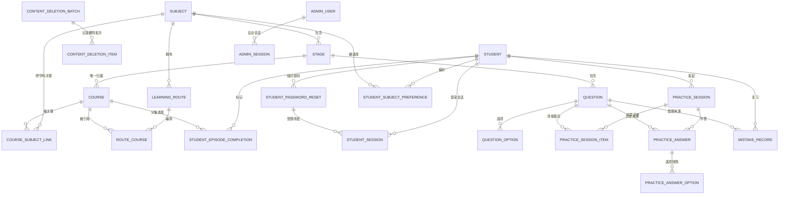

# 云枢智学：数据库设计

> 状态：首发数据库设计**评审草案**。对应 [`schema.sql`](../../scripts/sql/schema.sql) 仅用于空库验证，尚未经用户审核确认，不得用于现有业务库或作为上线迁移脚本。表结构是候选方案，未经审核不得作为已确认的数据库模型。

## 1. 依据与范围

- 依据 `docs/design/01.功能模块梳理.md`、`docs/design/02.整体架构设计.md`、`docs/云枢智学-需求文档.md` 和 `docs/rules/database-rules.md`；以本轮和此前确认的首发范围处理材料间差异。
- 首发覆盖用户名密码、独立后台账号、课程与分集进度、客观题、阶段练习、错题、学习统计所需事实数据、登录锁定和接口频控。AI 面试、短信、第三方绑定、多角色、操作日志等属于后续规划，暂不预建未明确表结构。
- 用户已确认：历史作答保留作答时的题目、选项与答案快照；错题重做使用当前已上架版本，下架或逻辑删除期间不可重做；学员逻辑删除后原用户名不可被新账号复用，恢复旧账号保留原学习记录。完整删除恢复流程及历史展示的具体交互仍须明确。
- 本文定义数据结构，不设计 API 路径、请求/响应契约，也不实现业务代码。模型、状态、索引及删除策略需用户审核，不能因脚本通过执行即视为业务验收完成。

## 2. SQLite 设计约定

1. 表名、列名及索引名使用小写 `snake_case`，表名统一单数；所有业务表以 `id INTEGER PRIMARY KEY AUTOINCREMENT` 自增，避免自动分配的已提交历史标识被复用。SQLite 的 `AUTOINCREMENT` 有额外开销，选择它是为满足项目主键规范并保持标识稳定，而非提升性能。[SQLite 官方说明](https://www.sqlite.org/autoinc.html)
2. 所有 `*_id` 均为**逻辑关联**，无物理外键；服务端在同一业务操作中检查关联存在性、所属关系与状态，并处理删除与恢复时的引用一致性。不得在 SQL、ORM 或迁移中创建物理外键。
3. 时间列为 `TEXT`，由应用统一写入固定精度、带 `Z` 的 UTC ISO 8601 文本；必须统一格式，才能保证文本比较可用于时间窗口。用户已确认学习日按 `Asia/Shanghai` 自然日计算；其他展示时区规则待明确。时间列格式由应用校验，SQLite 列类型本身不保证时间合法。
4. `INTEGER` 的布尔值用 `0/1` 并设 `CHECK`；状态枚举见第 5 节。SQLite 默认采用动态类型，声明的类型不等于严格类型校验，应用仍须验证输入。[SQLite 类型说明](https://www.sqlite.org/datatype3.html)
5. 业务对象采用可空 `deleted_at` 标记逻辑删除；分集进度用 `revoked_at`、错题用 `removed_at` 表示特定用户操作，不将其等同于删除整门课程或学员。历史作答是事实记录，默认不随题目修改或内容下架被改写。
6. 学员用户名全局唯一约束跨越逻辑删除，防止复用。学科名和阶段名逻辑删除后允许新记录复用；恢复冲突时旧名称追加“（已恢复）”，仍冲突追加递增编号。课程不展示也不使用 BV 号，按保存的完整课程链接严格相等去重；同一课程不同参数的链接可能无法识别为重复。草案对有效记录使用部分唯一索引；不能为解除链接冲突而擅自修改外部链接。[SQLite 部分唯一索引](https://www.sqlite.org/partialindex.html)
7. 数据库存储持久频控计数、登录失败计数和锁定期限；账户维度标识的规范化、隐私保护、清理策略及其他频控阈值待设计，不存明文密码或验证码。

## 3. 逻辑实体关系

该图只说明逻辑关系，**不代表物理外键**；图中的必选关系由 `NOT NULL` 和应用校验共同保障。`admin_user`、`admin_session`、`login_lock`、`rate_limit_counter` 为账号和防护支撑表，按账号域隔离。课程所属学科通过 `course.stage_id → stage.subject_id` 推导；`course_subject_link` 只保存其他学科的关联，服务端应禁止重复写入归属学科。路线归属一个学科，可引用其他学科课程，但不改变阶段完成条件。

## 4. 表结构与字段字典

字段标记：`!` 表示 `NOT NULL`；`?` 表示可空；`PK` 为自增主键。所有表的 `id` 均为 `INTEGER PK`，下表不重复列出。`created_at`、`updated_at` 等 UTC 时间为 `TEXT`；SQL 是字段与约束的执行草案，本表为业务解释。只列出 SQL 中真实存在的字段，不把规划中的功能虚构为已有字段。

| 表 | 字段（名称：类型与可空性） | 职责、逻辑关联与关键约束 |
|---|---|---|
| `student` | `username TEXT!`、`password_hash TEXT!`、`nickname TEXT?`、`avatar_path TEXT?`、`onboarding_completed_at TEXT?`、`created_at TEXT!`、`updated_at TEXT!`、`deleted_at TEXT?` | 学员账号及资料；`username` 全局唯一且非空；`password_hash` 保存原密码哈希。`onboarding_completed_at` 为首次偏好引导已选择或已跳过的时间，为空表示尚未处理；不区分选择或跳过，偏好另由 `student_subject_preference` 保存 |
| `student_password_reset` | `student_id INTEGER!`、`temporary_password_hash TEXT!`、`created_at TEXT!`、`consumed_at TEXT?`、`revoked_at TEXT?` | 候选模型：临时密码哈希独立于原密码；每名学员最多一个未消费且未撤销的临时密码。成功使用一次后消费，不设时间期限；使用后关闭页面且未改密时，可用原密码或联系管理员重新生成。新密码设置成功后本次改密会话进入平台、该学员其他已有会话失效；受限改密会话、并发消费与会话失效机制仍未确定，不能仅凭本表宣称已实现一次性流程 |
| `student_session` | `student_id INTEGER!`、`session_token_hash TEXT!`、`session_purpose TEXT!`、`password_reset_id INTEGER?`、`created_at TEXT!`、`expires_at TEXT!`、`revoked_at TEXT?` | 候选模型：服务端保存学员会话状态，凭据只保存哈希；普通会话自登录成功起固定有效 7 天；临时密码登录后的受限改密会话须逻辑关联临时密码记录，固定有效 15 分钟。改密成功后，本次会话转换为普通会话并从成功时重新计算 7 天，其他会话撤销；Cookie 凭据轮换及安全细节另行设计 |
| `admin_user` | `username TEXT!`、`password_hash TEXT!`、`created_at TEXT!`、`updated_at TEXT!`、`deleted_at TEXT?` | 独立后台账号；用户名全局唯一；草案用有效记录单例索引限制最多一名管理员。该约束如何兼容后续多角色扩展须在后续迭代迁移时调整 |
| `admin_session` | `admin_user_id INTEGER!`、`session_token_hash TEXT!`、`created_at TEXT!`、`expires_at TEXT!`、`revoked_at TEXT?` | 后台独立 SQLite 会话；凭据只存哈希，固定有效 7 天；逻辑关联管理员，生效和撤销由服务端校验 |
| `login_lock` | `account_domain TEXT!`、`account_key TEXT!`、`failed_count INTEGER!`、`locked_until TEXT?`、`updated_at TEXT!` | 候选表按学员/后台账号域隔离；首发已确认仅学员账号连续 5 次密码错误锁定 5 分钟，后台使用独立登录请求频控，不按账号连续错误次数锁定；同一来源 IP 每 5 分钟最多 10 次，请求计数保存在 `rate_limit_counter`；采用固定 5 分钟窗口；域与账号键组合唯一；账号键大小写、未注册账号处理与隐私策略待定 |
| `rate_limit_counter` | `action TEXT!`、`dimension_type TEXT!`、`dimension_key TEXT!`、`window_start_at TEXT!`、`expires_at TEXT!`、`request_count INTEGER!` | 按操作、维度及时间窗口保存频控计数；组合唯一、到期时间索引用于清理。后台登录使用固定 5 分钟窗口，其他操作窗口算法、范围与阈值待确认 |
| `subject` | `name TEXT!`、`icon TEXT?`、`description TEXT?`、`sort_order INTEGER!`、`created_at TEXT!`、`updated_at TEXT!`、`deleted_at TEXT?` | 学科；有效名称唯一；不预置具体学科数据 |
| `stage` | `subject_id INTEGER!`、`name TEXT!`、`sort_order INTEGER!`、`is_enabled INTEGER!`、`created_at TEXT!`、`updated_at TEXT!`、`deleted_at TEXT?` | 阶段逻辑关联 `subject.id`；同学科下有效阶段名称唯一；禁用时阶段题目及进行中练习受限，历史作答保留；已上架且未删除的所属课程仍可访问和标记分集 |
| `content_deletion_batch` | `root_type TEXT!`、`root_id INTEGER!`、`created_at TEXT!` | 候选模型：一次学科或阶段级联删除的根对象和时间；逻辑关联 root，必须由应用验证 |
| `content_deletion_item` | `batch_id INTEGER!`、`entity_type TEXT!`、`entity_id INTEGER!`、`restored_at TEXT?` | 记录一次删除操作实际标记的对象；同一对象至多存在一条未恢复的删除记录，以免误恢复此前已删除内容。父级有效时允许逐项恢复批次中的课程或题目；对应条目 `restored_at` 与实体恢复由应用同一事务维护，整批恢复跳过已恢复条目；可仅恢复学科或阶段，更新对应条目的 `restored_at`；阶段恢复须所属学科有效；重删并发待验证 |
| `course` | `stage_id INTEGER!`、`title TEXT!`、`course_url TEXT!`、`total_episodes INTEGER!`、`status TEXT!`、`cover_url TEXT?`、`duration_minutes INTEGER?`、`description TEXT?`、`created_at TEXT!`、`updated_at TEXT!`、`deleted_at TEXT?` | 课程唯一归属阶段；不存独立 BV 号；有效课程按完整链接严格相等唯一，链接参数不同可重复；旧课程链接与有效课程冲突时，暂停整个批次恢复 |
| `course_subject_link` | `course_id INTEGER!`、`subject_id INTEGER!`、`created_at TEXT!`、`deleted_at TEXT?` | 课程与**非归属学科**关联；有效课程/学科组合唯一；逻辑关联课程及学科 |
| `learning_route` | `subject_id INTEGER!`、`name TEXT!`、`description TEXT?`、`is_enabled INTEGER!`、`created_at TEXT!`、`updated_at TEXT!`、`deleted_at TEXT?` | 每条路线归属一个学科，启用状态控制展示；一学科多路线的展示优先级待确认 |
| `route_course` | `route_id INTEGER!`、`course_id INTEGER!`、`sort_order INTEGER!`、`created_at TEXT!`、`deleted_at TEXT?` | 路线有序引用课程；同一有效路线的课程、排序号分别唯一；排序交换须避免临时唯一冲突 |
| `student_episode_completion` | `student_id INTEGER!`、`course_id INTEGER!`、`episode_number INTEGER!`、`completed_at TEXT!`、`revoked_at TEXT?` | 每学员/课程/分集至多一行，同一学员跨路线共享进度；仅记录曾标记的分集，撤销设置 `revoked_at`，重新标记须清除它；超出当前总集数的历史记录保留但不计入当前进度 |
| `question` | `stage_id INTEGER!`、`question_type TEXT!`、`difficulty TEXT!`、`prompt TEXT!`、`explanation TEXT?`、`reference_source TEXT?`、`status TEXT!`、`answer_revision INTEGER!`、`last_published_fingerprint TEXT?`、`created_at TEXT!`、`updated_at TEXT!`、`deleted_at TEXT?` | 阶段客观题；来源供内部追溯；`last_published_fingerprint` 是上次成功上架的题干、选项和标准答案的比较用指纹，从未上架可空，已上架不得为空。题型不纳入此重置指纹；`answer_revision` 从 1 起递增，题型、题干、选项或标准答案发生实际改变时由应用在同一事务递增；旧页面作答校验使用独立版本号；具体指纹计算规范待定；上架前答案和解析是否必填须确认并由服务端校验 |
| `question_option` | `question_id INTEGER!`、`option_order INTEGER!`、`content TEXT!`、`is_correct INTEGER!` | 当前题目选项及正确答案；同题选项顺序唯一。单选/判断恰好一个正确选项，多选至少一个的跨行规则由服务端保证 |
| `practice_session` | `student_id INTEGER!`、`session_type TEXT!`、`stage_id INTEGER?`、`status TEXT!`、`question_count INTEGER!`、`started_at TEXT!`、`completed_at TEXT?` | 练习轮次；阶段练习须有 `stage_id`、错题复习为空；候选设计中当前有效题数为 0–10，零题不能标记完成；完成状态须有完成时间。允许恢复未完成轮次；同一学员最多一轮 `in_progress`，使用部分唯一索引约束；手动放弃与全部题目因下架或题目、所属阶段、学科逻辑删除或所属阶段被禁用而不可作答且无已判定作答时自动结束均为未完成，候选使用 `abandoned`；具体并发方案待验证 |
| `practice_session_item` | `session_id INTEGER!`、`question_id INTEGER!`、`question_order INTEGER!`、`presented_fingerprint TEXT?`、`item_status TEXT!`、`created_at TEXT!`、`updated_at TEXT!` | 服务端保存每轮题目清单与发给学员的版本标识；同轮题目及顺序各自唯一。尚未向学员提供题目时指纹可空；首次展示及因版本变更重新获取后由服务端更新标识。状态与作答、有效题数的一致性由服务端维护；这是候选模型，允许恢复未完成轮次；具体并发校验及恢复入口须细化 |
| `practice_answer` | `session_id INTEGER!`、`question_id INTEGER!`、`question_type_snapshot TEXT!`、`prompt_snapshot TEXT!`、`explanation_snapshot TEXT?`、`is_correct INTEGER!`、`answered_at TEXT!` | 一轮一次题目作答及题干、类型、解析快照；同轮同题唯一。重复提交只计一次并返回首次已保存判定；历史判定不跟随题目更改 |
| `practice_answer_option` | `practice_answer_id INTEGER!`、`option_order INTEGER!`、`content_snapshot TEXT!`、`is_correct_snapshot INTEGER!`、`is_selected INTEGER!` | 保存作答时每个选项文本、正确标识与用户选择；同次作答选项顺序唯一，不依赖当前选项记录 |
| `mistake_record` | `student_id INTEGER!`、`question_id INTEGER!`、`last_wrong_answer_id INTEGER!`、`error_count INTEGER!`、`consecutive_correct INTEGER!`、`last_wrong_at TEXT!`、`removed_at TEXT?` | 学员/题目唯一错题状态，保存最近错误作答的快照引用；重做前由服务端检查当前题目已上架且未删除。连续正确 3 次视为掌握；待复习题答错时连续纠正次数清零，已掌握题再次答错保持已掌握并增加累计错误次数；题干、选项或答案实质修改后重新核验上架时重置连续纠正次数。移除后再次答错时清除 `removed_at`，累计错误次数递增，连续纠正次数归零并回到待复习，包括移除前已掌握的题目 |
| `student_subject_preference` | `student_id INTEGER!`、`subject_id INTEGER!`、`created_at TEXT!` | 学员学习方向偏好；组合唯一；首次引导选择或跳过的处理时间记录于 `student.onboarding_completed_at`，此表没有偏好记录不代表引导尚未处理 |

## 5. 枚举、统计与事务边界

| 字段 | 取值 |
|---|---|
| `question.question_type`、`practice_answer.question_type_snapshot` | `single` 单选、`multiple` 多选、`judgment` 判断；简答后续单独设计 |
| `question.difficulty` | `easy` 简单、`medium` 中等、`hard` 困难 |
| `course.status` | `published` 已上架、`unpublished` 未上架或已下架；与 `deleted_at` 独立，创建时由服务端明确指定，阶段完成只纳入已上架且未删除课程 |
| `question.status` | `draft` 草稿、`published` 已上架、`unpublished` 已下架；首发采用管理员人工核验，不预设后续审核流 |
| `practice_session.session_type` | `stage` 阶段练习、`mistake` 全局错题复习 |
| `practice_session.status` | `in_progress` 进行中、`completed` 完成、`abandoned` 放弃；每学员最多一轮进行中；候选 `abandoned` 同时表示手动放弃和题目全部因下架或题目、所属阶段、学科逻辑删除或所属阶段被禁用而不可作答且无判定作答时自动结束，当前无法区分结束原因 |
| `practice_session_item.item_status` | 候选模型：`pending` 待作答、`answered` 已判定、`removed` 从本轮移除；状态迁移由服务端校验；`removed` 题目即使恢复可用也不回填该轮，后续新练习可再抽取 |
| `student_session.session_purpose` | 候选模型：`normal` 普通学员会话、`password_reset` 受限改密会话；权限与会话切换由服务端校验 |
| `login_lock.account_domain` | `student` 学员端、`admin` 管理端 |
| `rate_limit_counter.dimension_type` | `ip` IP 维度、`account` 账号维度；具体规范化、阈值待确认 |
| `content_deletion_batch.root_type` | `subject` 学科、`stage` 阶段 |
| `content_deletion_item.entity_type` | `subject`、`stage`、`course`、`question`、`learning_route`、`course_subject_link`、`route_course`；具体级联对象范围以用户确认与服务端校验为准 |

- 正确率来源为全部已提交并判定的单题作答：`practice_answer` 中正确次数 / 作答次数，包含未完成轮次中的已判定作答；不能按 `practice_session.status = 'completed'` 过滤分子或分母。未完成轮次中的错误作答也进入错题本。
- 阶段练习次数、错题复习次数以 `practice_session.status = 'completed'` 分开统计。学习日以已完成轮次为依据，并按 `Asia/Shanghai` 自然日计算，避免重复计数；阶段完成只计算当前已上架且未逻辑删除的归属课程，要求至少有一门符合条件的课程、全部符合条件课程的当前分集完成及至少一次该阶段完整练习；无符合条件的归属课程时不能完成，不得因空集合而误判为完成。不在本草案另设冗余阶段状态表。
- 作答记录、选项快照、错题更新作为同一业务单元提交或回滚；完成练习的状态与完成时间须一致。具体事务隔离与重试策略在实施前验证。
- **已确认重复提交规则**：服务端先验证当前学员对轮次及题目的访问资格；同轮同题已有作答时返回首次保存的判定结果，不重新判分或重复修改错题和统计。唯一约束只提供防重复写入防线，并发冲突处理和返回结果一致性须在业务实现中验证。
- **学员会话候选边界**：普通学员会话自登录成功起固定有效 7 天；普通登录态改密成功后本次会话从成功时重新计算 7 天；临时密码本身一次有效且不设时间期限，临时密码登录后的受限改密会话固定有效 15 分钟，改密成功后转换为普通会话并从成功时重新计算 7 天。服务端负责计算和校验到期时间；`NOT NULL` 只保证到期时间存在，不能保证期限数值正确。临时密码消费与受限会话创建须保证一致；新密码设置成功后，更新密码、保留并转换本次会话、撤销该学员其他已有会话须一致提交。改密完成前受限会话不能当作普通会话；凭据校验、传输和并发细节仍待设计，不能仅凭字段约束声称已实现。
- 已上架题目的题干、选项或标准答案需实质修改时先下架。首次成功上架保存指纹基线；重新核验、上架时，将最终内容计算出的指纹与 `last_published_fingerprint` 比较：不同则重置相关 `mistake_record.consecutive_correct`，相同则不重置，随后保存新指纹。编辑后改回原样不重置；题型、解析或内部来源不进入此重置指纹；单独修改题型、解析或内部来源不触发重置。题型变化可能影响判分，须使用独立于重置指纹的版本校验拒绝过时作答，具体标识及并发方案待设计。历史作答及 `error_count` 不改写；按连续答对 3 次推导的已掌握状态随重置回退。
- 服务端应将上架、必要的错题计数重置及指纹更新作为同一事务提交或回滚，并防止并发或重复上架导致重复副作用。指纹不能代替作答快照，也不能还原题干或答案。字段排序、序列化、算法及规则变更版本须在实现前确定并保持稳定；对曾上架却缺失基线的异常数据不能默认为首次上架或静默跳过，具体修复流程待确认。
- **已确认的进行中练习规则**：学员已打开但未提交的题目发生实质更新并重新上架时，旧答案不判分，提示学员重新获取当前已上架版本；已提交并判定的历史作答及快照保留。学员准备提交时题目仍下架或题目、所属阶段、学科被逻辑删除或所属阶段被禁用导致不可作答，则从本轮移除该题、减少本轮题数，旧答案不判分；完成其余题目后即可完成本轮。若所有题目均被移除且没有已判定作答，本轮以未完成结束，不计完整练习次数和学习日。服务端须能识别作答所针对的内容版本，并在判分与写入时核对题目当前上架状态及版本；并发一致性须在实施前验证。其他原因无法获取题目时的处理仍待确认。
- **抽题清单与版本识别**：用户已确认由服务端保存本轮题目清单与版本标识，草案新增 `practice_session_item` 记录题目顺序和提供给学员的指纹；这是版本校验和恢复未完成轮次的数据基础，具体恢复与并发流程仍需设计。该字段若使用重置指纹，不能识别单独变更题型，不能作为唯一作答版本依据；已确认新增 `question.answer_revision`，影响判分内容实际变化时递增，签名令牌绑定该版本。对于同一题重复加载、多个页面并发打开、题目更新后旧页面延迟提交及指纹变回原值等情况，仅凭单个服务端字段尚不足以证明请求与具体展示内容对应；需要在接口/事务细化阶段设计请求关联与并发保护，并用测试验证，不得将具体接口契约视为本轮已确定。
- 频控检查和计数更新需要原子操作以防止并发绕过；SQLite 单写入者的限制可能造成竞争，故不得以本草案推断高并发承载能力。

## 6. 删除、唯一约束与关联完整性

| 场景 | 草案处理 | 待确认 / 应用层责任 |
|---|---|---|
| 学员逻辑删除与恢复 | `student.deleted_at` 标记；用户名全局保留；历史练习、错题与进度保留 | 恢复权限、删除期间能否登录及关联数据的展示策略待确认；禁止重用用户名是用户已确认规则 |
| 学科、阶段、课程、路线、题目 | 学科或阶段删除时，其归属阶段下的课程一并逻辑删除；其他路线引用会受影响，操作前须提示。恢复时只自动恢复本次级联删除的内容，先前已删除内容不恢复；共享课程恢复后，仍有效路线的原引用自动重新可见，先前单独移除的引用不恢复 | 候选删除批次明细仅记录本次实际从有效变为删除的对象；由服务端确保记录与业务数据在同一事务一致。恢复顺序、并发与引用校验须验证 |
| 分集撤销及集数减少 | 用 `revoked_at` 表示撤销；超出当前总集数的历史完成行保留 | 只计算当前集数范围且 `revoked_at IS NULL` 的行；恢复集数后历史状态再次生效 |
| 错题移除 | 使用 `removed_at`，不删除历史作答 | 再次答错时清除 `removed_at` 并更新最近错误作答引用和时间，累计错误次数加一、连续纠正次数归零；移除前已掌握亦回到待复习。首发不提供手动移除入口；该字段及再次答错恢复规则为后续扩展或已有状态兼容保留 |
| 学科/阶段名称逻辑删除后复用 | 允许复用；恢复冲突时旧名称后加“（已恢复）”，如仍冲突追加递增编号 | 草案部分唯一索引支持复用；并发命名冲突和批量恢复事务须验证 |
| 课程链接 | 有效课程完整链接严格相等时唯一；逻辑删除后可以复用 | 参数不同的链接不会自动识别为同一课程；恢复批次内旧课程链接若被有效课程占用，则暂停整个批次恢复、提示管理员处理，禁止自动改写外部链接。必须在应用事务中保证未发生部分恢复 |
| 频控过期记录 | 按 `expires_at` 定期清理为建议 | 清理触发方式、失败恢复及保留期限待确认；这类临时状态与学员历史数据的逻辑删除语义不同 |

所有逻辑关联的新增、修改、删除、恢复，以及跨学科课程关联、选项正确数、练习完成是否答满等跨行/跨表规则，由服务端执行校验；脚本中的 `CHECK` 不能替代这些检查。

## 7. 与首发需求的覆盖检查

| 需求 | 设计支撑 | 尚需核对 |
|---|---|---|
| 三个学科、阶段、跨学科课程与路线 | `subject`、`stage`、`course`、`course_subject_link`、`learning_route`、`route_course` | 首批课程及题目内容不在建表脚本中；删除/恢复关联策略待确认 |
| 手动分集进度、集数变更、阶段回退 | `student_episode_completion`、`course.total_episodes`；阶段完成按事实数据计算 | 仅计算当前已上架且未逻辑删除的归属课程；无符合条件的课程时不完成 |
| 固定最多 10 题、逐题判定和错题 | `question`、`question_option`、`practice_session`、`practice_answer`、`mistake_record` | 已掌握题再次答错保持已掌握、累计错误次数增加；错题复习仅抽取未移除、未掌握且当前可作答的错题；全部题目因下架或题目、所属阶段、学科逻辑删除或所属阶段被禁用而不可作答且无判定作答时自动结束为未完成，候选用 `abandoned`，并发实现待验证 |
| 历史作答真实可追溯 | `practice_answer` 与 `practice_answer_option` 保存题干、解析、选项、标准答案与用户选择 | 保存当时所属阶段/学科名称及难度是否需要快照待确认；当前按题目关联查询 |
| 用户名密码与恢复 | `student`、`student_password_reset`、`student_session`、`admin_user`、`login_lock`、`rate_limit_counter` | 已确认学员会话状态存 SQLite；临时密码一次有效、不设时间期限；原密码在成功设置新密码前有效，成功设置后本次会话进入平台、其他已有会话失效。候选表尚需验证并发与会话失效实现；脚本不生成管理员账号或密码 |
| 偏好与个人统计 | `student.onboarding_completed_at`、`student_subject_preference`、练习和课程进度事实表 | 首次引导选择或跳过均记录处理时间；首发使用默认头像，不提供上传；`avatar_path` 为保留字段，不能视为首发上传能力 |

## 8. 本轮待确认问题与审核说明

1. **已确认**：题目编辑后历史作答保留当时快照，历史判定不变；错题重做使用当前已上架版本，下架或逻辑删除期间暂不可重做；账号逻辑删除后用户名不可复用，恢复原账号保留学习记录。
2. **已确认部分作答口径**：中途退出未完成轮次时，已提交并判定的作答仍计入总体正确率，错误作答进入错题本；该轮不计完整练习次数或学习日。重复提交同轮同题返回首次结果且不重复计数；并发实现待验证。
3. **后续逐项确认**：共享课程引用与其他关联内容的恢复顺序；受限改密会话、其他会话失效机制与临时密码并发消费；指纹的稳定计算规范、版本核验与并发处理细节、其他原因无法获取题目的处理；首发接口频控范围与具体算法。
4. **覆盖限制**：本稿未设计后续 AI 面试、短信验证码、第三方绑定、多角色权限和日志表；若项目要求本阶段输出完整规划的数据库模型，应先确认范围及相关业务规则。服务端抽题清单、版本标识、学员会话及临时密码表均为候选模型，指纹计算、受限改密会话、并发和异常处理尚未实施验证；头像文件生命周期等尚待细化，不应宣称 DDL 可直接进入开发。
5. **审核门槛**：确认范围、字段、约束、时间、删除/恢复、业务规则和 SQL 的适用性后，才可将脚本升级为正式建表或迁移输入；执行前必须选择独立空库并确认目标，禁止直接覆盖已有数据。

## 9. 当前需求快照

- **已确认结论**：SQLite + SQLAlchemy；逻辑关联不建物理外键；历史作答快照不随题目修改；已删除学员用户名不复用且恢复保留记录。
- **待确认清单**：恢复顺序及并发冲突、Cookie 安全细节、版本并发处理及频控细节等。
- **本轮新增结论**：临时密码登录后的受限改密会话有效 15 分钟，改密成功后普通会话的 7 天从成功时起算；已掌握题再次答错仍保持已掌握，仅累计错误次数增加。

- **本轮补充确认**：阶段仅计算当前已上架且未逻辑删除的归属课程，无符合条件课程时不能完成；移除的错题再次答错后重新显示，累计错误次数保留并递增、连续纠正次数归零。

- **API 阶段新确认**：两端独立 HttpOnly Cookie；学员可继续未完成练习；后台 SQLite 独立会话有效 7 天。`admin_session` 为依此补充的评审模型。

- **本轮补充确认**：每学员最多一轮进行中练习（阶段与错题复习共用），草案新增部分唯一索引；注册后手动登录；错题复习仅抽取未移除、未掌握且可作答题目。手动放弃及全部题目因下架或题目、所属阶段、学科逻辑删除或所属阶段被禁用而不可作答且无判定作答时自动结束均不计完整练习及学习日。

- **API 阶段确认**：手动放弃保留已判定作答和错题；全部题目因下架或题目、所属阶段、学科逻辑删除或所属阶段被禁用而不可作答且无作答的轮次自动结束为未完成。候选均记 `abandoned`，不区分原因；业务实现须保证状态更新与下架、判分并发一致。

- **API 阶段补充确认**：题目下架、题目或其所属阶段与学科逻辑删除采用相同不可作答处理；普通登录态改密验证原密码，成功后保持本次登录并撤销其他学员会话。普通会话改密成功后，本次会话到期时间从成功时起重新计算 7 天。

**API 阶段本轮确认**：普通登录态修改密码成功后，本次会话的 7 天有效期从成功时重新计算；阶段被禁用时，其进行中练习的未作答题按题目不可用规则处理，全部不可用且无已判定作答则自动结束为未完成。

- **API 阶段补充确认**：创建练习时可用题为 1–9 题按实际数量开始；零题不创建轮次。已从一轮移除的题目恢复可用时不回填原轮，后续新练习可再抽取。

- **API 阶段补充确认**：首发不提供错题移除入口；`removed_at` 及相关恢复规则保留作后续扩展或已有状态兼容。阶段禁用不阻止访问已上架且未删除的所属课程或标记进度。

**整体评审新增确认**：首发错题本仅提供错题列表与复习，统计卡和高频错题 Top 3 推迟；题库详情允许查看答案和解析，练习展示接口作答前不返回答案；单独删除的课程、题目及路线需要恢复，若所属阶段或学科已删除，暂停恢复并提示先恢复父级。

**整体评审补充确认**：单独删除课程、题目和路线后恢复为删除前的上架或启用状态；单独删除课程时保留路线引用并暂时隐藏，恢复后在仍有效路线自动显示。练习展示采用服务端签名临时令牌，提交事务校验当前题目版本和轮次归属；版本标识及并发方案尚待细化。

- **整体评审新确认**：新增 `question.answer_revision` 与掌握重置指纹分离；影响判分的题型、题干、选项或标准答案发生实际变更时事务递增，即使之后改回原样也不复用旧版本。令牌密钥、异常并发和状态变化的校验仍须细化与测试。

- **本轮补充确认**：父级有效时允许逐项恢复级联删除的课程或题目；学员连续 5 次密码错误锁 5 分钟，后台账号锁定规则另定；游客可查看题库详情与解析。允许仅恢复学科或阶段本身，也可整批恢复剩余条目。

- **本轮补充确认**：学科和阶段可只恢复本身，父子对象恢复与批次明细须分别在同一事务维护；整批恢复跳过已恢复条目，本次冲突回滚不得撤销之前的单项恢复。后台登录使用独立请求频控，不按账号连续错误次数锁定；同一来源 IP 每个固定 5 分钟窗口最多 10 次。

- **本轮新增确认**：后台登录同一来源 IP 每 5 分钟最多 10 次，请求频控持久写入 SQLite 并在重启后按窗口继续生效；普通登录态改密成功时，更新密码、保留本次会话、撤销其他会话及尚未使用的临时密码须一致提交。

- **本轮补充确认**：后台登录以固定 5 分钟窗口计数，同一来源 IP 每窗口最多放行 10 次；`rate_limit_counter` 的窗口起止及计数持久化，检查和更新需原子化。固定窗口使用 UTC 300 秒对齐、左闭右开为 API 评审细化；并发和可信代理取 IP 待验证。

- **本轮新增确认**：首发不允许变更课程所属阶段；删除重录为新课程，既有学员分集记录仍指向旧课程，不自动迁移。首发使用默认头像，数据库 `avatar_path` 字段保留，但不开放上传。
